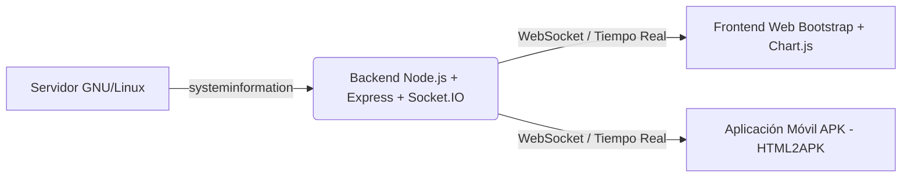
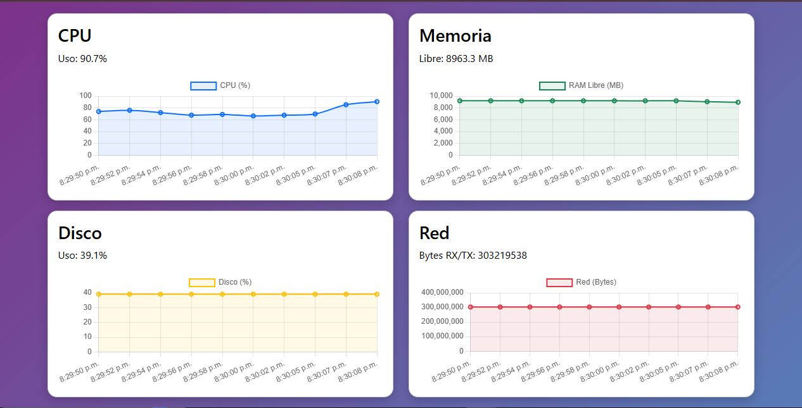
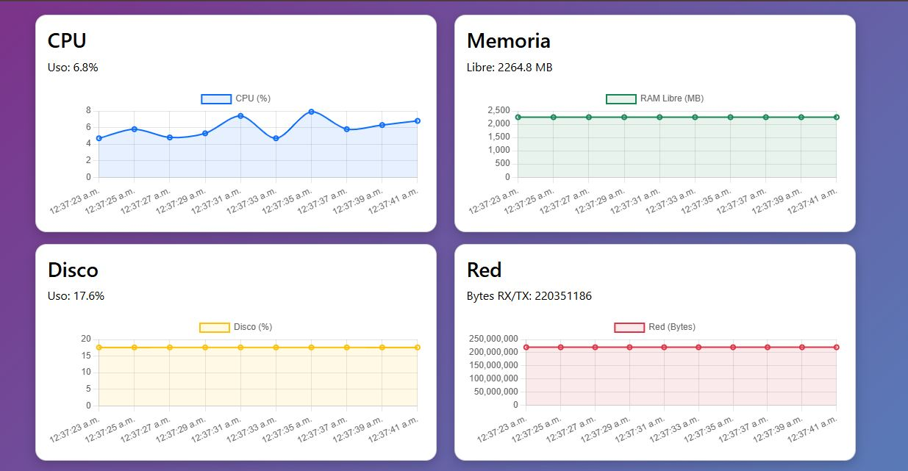
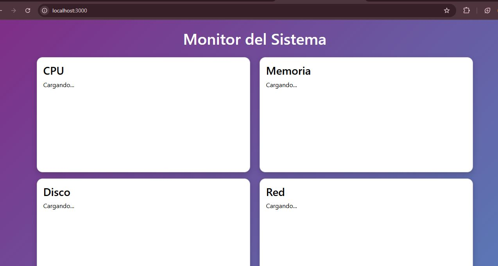
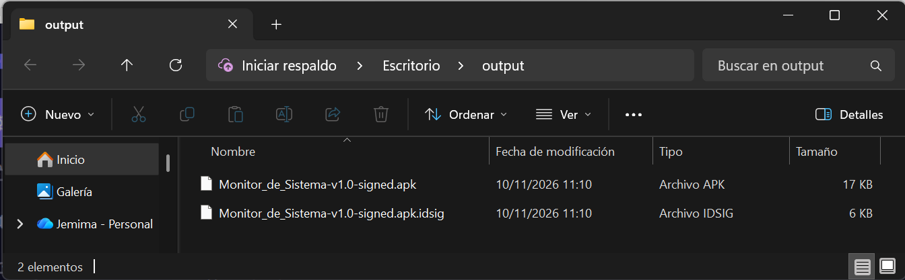

# TP Integrador Final - Monitoreo de Sistema en Tiempo Real
  
**Cátedra:** Práctica Profesionalizante III - 2026
---

## 1. Descripción

El proyecto consiste en una aplicación de monitoreo de sistema en tiempo real desarrollada bajo una arquitectura cliente-servidor.

La solución permite visualizar métricas del servidor tales como:

- Uso de CPU.
- Memoria RAM.
- Espacio en disco.
- Estadísticas de red.
- Tiempo de actividad (uptime).

La obtención de datos se realiza mediante Node.js y la librería systeminformation, mientras que la visualización se implementa mediante HTML, CSS, Bootstrap y Chart.js.

## 2. Características

- Monitoreo en tiempo real.
- Visualización gráfica mediante Chart.js.
- Dashboard responsive.
- Comunicación mediante Socket.IO.
- Backend Node.js con Express.
- Despliegue en Debian.
- Conversión a aplicación Android (APK).

## 3. Tecnologías Utilizadas

La aplicación está desarrollada separando claramente el cliente y el servidor, cumpliendo con los estándares de la cátedra:
- **Frontend:** HTML5, CSS3, JavaScript (DOM, Fetch API), Bootstrap 5 (diseño responsivo y cards) y Chart.js para visualización de métricas.
- **Backend:** Node.js, Express, Socket.IO (comunicación en tiempo real), CORS y la librería `systeminformation` para la extracción de recursos del hardware GNU/Linux.
- **Control de versiones:** Git y GitHub (trabajo en ramas paralelas y merges).

## 4. Estructura del Proyecto

```text
Proyecto-final
│
├── backend
│   ├── server.js
│   ├── package.json
│
├── frontend
│   ├── index.html
│   ├── style.css
│   ├── app.js
│   └── manifest.json
│
├── docs
│
├── README.md
└── .gitignore
```
## 5. Requisitos

Para ejecutar el proyecto se requiere:

- Node.js v24 o superior.
- npm.
- Navegador web moderno.
- Debian GNU/Linux para despliegue de producción.
- Git.

## 6. Vista en el Navegador Web y en Dispositivo Móvil

La interfaz web muestra tarjetas estilizadas con Bootstrap y gráficos dinámicos actualizados segundo a segundo mediante WebSockets.
El frontend fue empaquetado exitosamente como aplicación Android mediante la herramienta HTML2APK-V2, obteniéndose una APK firmada lista para instalación y pruebas en dispositivos móviles.

## 7. Guía de Instalación y Puesta en Marcha Local

Sigue estos pasos para clonar el repositorio y ponerlo en funcionamiento en tu equipo:
a- Clonar el repositorio:
     git clone https://github.com/JemimaJofre22/Proyecto-final.git (https://github.com/JemimaJofre22/Proyecto-final.git)
b- cd Proyecto-final
c- Instalar las dependencias del Backend:
     cd backend
     npm install
d- Iniciar el servidor Node.js:
     npm start
(El servidor se iniciará por defecto en el puerto 3000).   
e- Acceder a la aplicación:
     Abre tu navegador web e ingresa a: http://localhost:3000

## 8. Despliegue en Servidor (Systemd)

Para garantizar que la aplicación se ejecute de manera continua y se levante automáticamente al reiniciar el servidor GNU/Linux, se configura como un servicio de Systemd:   
-Crear el archivo de servicio: sudo nano /etc/systemd/system/monitorsistema.service
-Configurar las rutas del directorio de trabajo y el comando de ejecución (node server.js).
-Habilitar y arrancar el servicio: 
   sudo systemctl daemon-reload
   sudo systemctl start monitorsistema
   sudo systemctl enable monitorsistema

## 9. GitHub Helpers y Enlaces de Interés

Conforme a las herramientas de apoyo solicitadas por la cátedra para la auditoría y análisis del repositorio, se pueden utilizar los siguientes helpers:
- Visualizador de Estructura / Git: GitDiagram para inspeccionar el flujo de trabajo de las ramas.
- Editor Web Instantáneo: GitHub1s para abrir el repositorio directamente con interfaz de VS Code en el navegador.
- Empaquetado APK: Generado mediante la herramienta HTML2APK para su distribución en dispositivos móviles

## 10. Arquitectura del Sistema y Despliegue

El sistema opera bajo una arquitectura cliente-servidor en tiempo real, donde el backend recopila datos del sistema operativo y los emite mediante WebSockets hacia las interfaces web y móviles.



## 11. Capturas de Pantalla

### Ejecución del Dashboard en Windows


### Ejecución del Dashboard en Debian


### Aplicación Web en Navegador


### APK Generada



## 12. Pruebas Realizadas

Se verificó correctamente:

- Obtención de métricas de CPU.
- Obtención de métricas de memoria RAM.
- Obtención de métricas de disco.
- Obtención de estadísticas de red.
- Comunicación entre frontend y backend.
- Funcionamiento del servicio Systemd en Debian.
- Acceso desde navegador web.

## 13. Problemas Conocidos

- La aplicación requiere permisos adecuados para acceder a determinadas métricas del sistema.
- Las estadísticas pueden variar según el hardware utilizado.

## 14. Mejoras Futuras

- Incorporar alertas por uso elevado de CPU.
- Incorporar autenticación de usuarios.
- Generar reportes históricos.
- Implementar almacenamiento de métricas.

## 15. Autores

- Estudiantes: Joanna y Jemima
- Materia: Práctica Profesionalizante III
- Institución: Instituto Técnico Superior

## 16. Conclusión

El proyecto permitió integrar herramientas de desarrollo frontend, backend y administración de sistemas Linux, aplicando conceptos de monitoreo, comunicación en tiempo real, despliegue de servicios y trabajo colaborativo mediante Git y GitHub.
